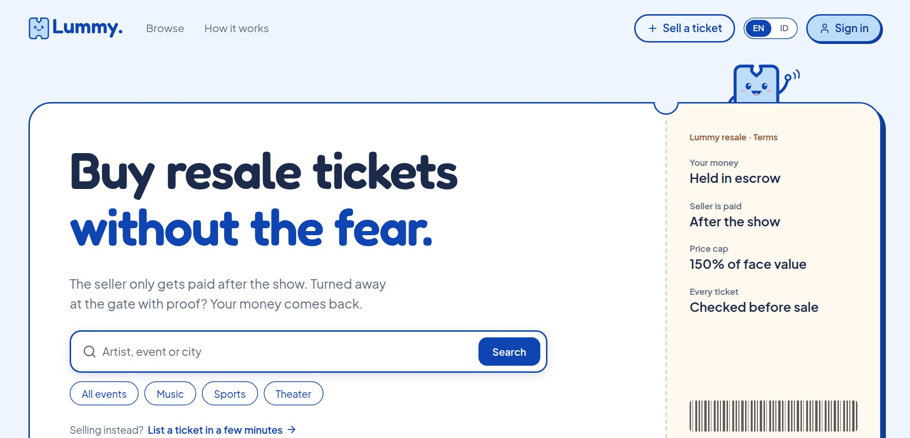
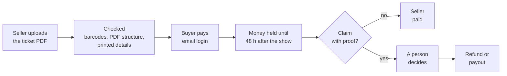

**Escrow-backed resale for concert tickets in Indonesia.**

The buyer's money is held until 48 hours after the show, and every ticket is checked before it goes on sale.
Sign in with email: no wallet, no seed phrase, no gas fee.

[<kbd>   Live site &nbsp;→   </kbd>](https://lummy.id)
&nbsp;
[<kbd>   How it works &nbsp;→   </kbd>](https://lummy.id/how-it-works)

 

 

---

## The problem

Buyers pay first, then get ghosted, handed a fake ticket, or one that has already been scanned. Deals happen in WhatsApp groups and X replies with nobody in the middle. After Coldplay's 2023 show in Jakarta, ticket-fraud victims reported losses of up to Rp1.3 billion to the police ([Kompas TV](https://www.kompas.tv/nasional/461179/korban-penipuan-tiket-konser-coldplay-lapor-polisi-kerugian-hingga-rp1-3-miliar)), and the trade ministry questioned the promoter over consumer ticket complaints ([Bisnis.com](https://ekonomi.bisnis.com/read/20231203/12/1720382/kemendag-cecar-promotor-soal-aduan-tiket-konser-coldplay-rugikan-konsumen)).

Many Indonesian tickets are also **name-locked**. At the gate, the QR is exchanged for a wristband against a government ID, so a ticket cannot simply change hands. Where the organiser allows a transfer, it takes a letter of authorisation signed over a stamp duty seal (meterai) and a copy of the seller's ID, and today people put that together by hand in a group chat. That paperwork is part of why resale stays in chats, and part of what a trusted middle can take off people's hands.

## How it works

### The money

The seller is only paid after the show, so there is nothing to take and disappear with. If no claim stands within 48 hours of the show ending, the payout happens on its own. A buyer turned away at the gate with proof gets the money back, and a seller whose ticket fails loses the sale and pays a 40% penalty, so selling a bad ticket never pays. Resale is capped at 150% of face value.

### The tickets

Every listing is checked before it goes on sale:

- **Barcodes.** Every barcode in the PDF is read, normalised and hashed with a secret key, then matched against every live listing. A barcode already on sale is blocked outright, and the escrow contract refuses a commitment it already holds.
- **PDF structure.** Forensics look for signs of editing, such as the trace a PDF editor leaves. A flagged ticket waits for a person: the score is a signal for a human, not a verdict.
- **Printed details.** Claude, Anthropic's model, reads the ticket's text after names, numbers and codes are taken out. It fills in the show and category, reads the seat, and reads the ticket again at publish to cross-check what the seller entered.
- **Handover papers.** For shows that check names, the buyer and the seller each download a draft letter of authorisation filled in from the order. The seller signs it over a paper stamp; e-signature and e-stamp through a licensed provider come later.

> [!NOTE]
> What we do not claim: the checks catch duplicates and edits, not every cleanly made fake. Without the organiser's own data, our promise is that **your money comes back**, not that you are guaranteed entry. Payments run in test mode until our company is registered with the payment provider.

## Two payment rails, one public record

Crypto may not be used as payment in Indonesia, so for shows there, buyers pay rupiah by QRIS through a licensed payment provider (Xendit, in test mode for now). The provider holds the money, and a contract on Arbitrum records each order's life. For shows abroad, the buyer's Circle USDC goes into an escrow contract that holds it per listing until the window after the show closes. Escrow cycles have run on testnet with a simulated buyer; checkout from the buyer's own wallet is what we are building at Founder House.

| Contract | On Arbitrum Sepolia, source verified | What it does |
|---|---|---|
| `LummyEscrow` | [`0x6830…25Dd`](https://sepolia.arbiscan.io/address/0x6830Db86283157E4cB80b0615d4c51381A0C25Dd#code) | Holds USDC per listing, then releases it to the seller, refunds the buyer, or splits it on a ruling. Buyers sign; the platform sends the transaction and pays the gas |
| `LummyLedger` | [`0xe454…8b0E`](https://sepolia.arbiscan.io/address/0xe454cbc81916E9bE1e6A768715134568FCEE8b0E#code) | Records each QRIS order: paid, claimed, ruled, paid out, refunded |

In the escrow, once the window after a show closes without a dispute, anyone can release the seller's payout, even with our backend down. The contract takes no fee and has no way to sweep funds: money only goes to the listing's buyer or seller.

## Every step on chain, in plain words

An order's history is read straight from the contract's events on Arbitrum, not from our database, and shown as plain sentences: paid, handover recorded, claim filed, paid out. Each step links to its transaction as proof. Anyone can open an order's public proof page without an account, and the page holds no personal data. [See one that settled on Arbitrum Sepolia](https://lummy.id/proof/0xc9b869a2c8bba81a4e564ea2126c0651ecef9ddd612d94bd8818cca1f20666bc).

## Why escrow, and why Arbitrum

We spent a year on this problem before settling on the product. Our first build was full on-chain ticketing, and it taught us two things. Visible Web3 stops ordinary fans: wallets, gas fees, and signing pop-ups lost people who just wanted a ticket. And a full ticketing platform was far bigger than the problem fans actually have, which is getting cheated when they buy from a stranger.

So we kept blockchain in exactly one place: the money. For a sale between two strangers, a public contract beats our own word, because its rules and its history are open. We call it consumer escrow: the money is held until the show is over and released by what happens at the gate, for buyers who never see a wallet.

The contracts run on Arbitrum, an Ethereum L2, so they settle to Ethereum, and the escrow holds USDC issued by Circle. Users sign in with email; the platform submits the transactions and pays the gas.

## Why now

- **Live events are booming** in Indonesia post-2023, with K-pop tours and international festivals entering the market.
- **QRIS is everywhere**, so a mainstream payment rail exists that needs no crypto on-ramp.
- **Indonesia's data-protection law (UU PDP)** is pushing the market away from photocopied IDs and toward verified identity.

## Where we are (October 2026)

- **Live at [lummy.id](https://lummy.id):** email sign-in; buyer, seller and staff flows on a real database; claims with photo evidence the server reads; gate passes scanned at the door; cancelled and postponed shows; English and Indonesian.
- **Real ticket PDFs** have been checked since 1 October, and read by Claude since 20 October.
- **QRIS through Xendit** in test mode since 8 October. Real money waits for our company registration and the provider's business verification.
- **Contracts:** 110 Foundry tests, fuzzing and invariant runs included.
- **Beta** with real accounts, 19 to 31 October.
- **Arbitrum Founder House**, Singapore, 23 to 25 October: building USDC checkout from the buyer's own wallet for shows abroad.

## Stack

| Layer | What we build with |
|---|---|
| **App** | Next.js and TypeScript on Vercel. Supabase for Postgres, auth, storage, and row-level security |
| **Chain** | Solidity and Foundry on Arbitrum. Circle USDC through ERC-3009 and EIP-712 signatures, gas paid by the platform |
| **Ticket checks** | Barcode decoding with keyed-hash dedup, PDF structure forensics, Claude reading the printed details |
| **Money** | QRIS through Xendit, which holds the funds; the chain keeps the record |
| **Identity** | Planned: e-KYC, e-signature, and e-stamp through a licensed Indonesian provider (PSrE), so raw ID images never sit with us |

## Team

Zahra Sasongko, CEO · [LinkedIn](https://www.linkedin.com/in/zara-sasongko-a08292271/)

Luthfi Hadi, CTO · [@luthfidi](https://github.com/luthfidi) · [LinkedIn](https://linkedin.com/in/luthfi-hadi)

Joanita Timbin Panggalo, COO · [LinkedIn](https://www.linkedin.com/in/joanitatimbin/)

Jakarta, Indonesia · team@lummy.id · [Instagram](https://instagram.com/lummy.ticket) · [X](https://x.com/lummy_ticket) · [LinkedIn](https://linkedin.com/company/lummy-ticket)
