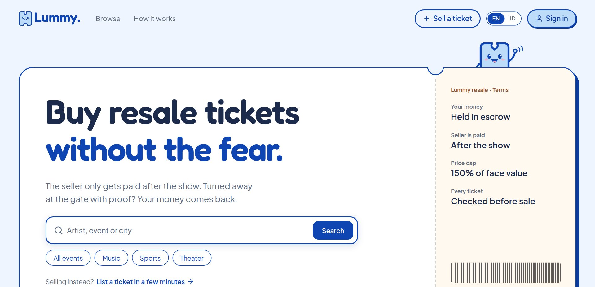
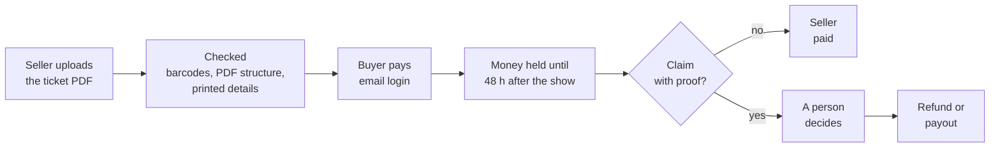

**Escrow-backed resale for concert tickets, starting in Indonesia.**

The buyer's money is held until 48 hours after the show, and every ticket is checked before it goes on sale.
Sign in with email. Shows in Indonesia need no wallet; shows abroad are paid in USDC, from your own wallet with no gas fee, or from another chain through NEAR Intents.

[<kbd>   Watch the demo (2:50) &nbsp;→   </kbd>](https://youtu.be/090tOYfTQ4I)
&nbsp;
[<kbd>   Watch the pitch &nbsp;→   </kbd>](https://youtu.be/DeOXEoOJfJ4)
&nbsp;
[<kbd>   Live site &nbsp;→   </kbd>](https://lummy.id)
&nbsp;
[<kbd>   Try a demo account &nbsp;→   </kbd>](https://lummy.id/login#demo)
&nbsp;
[<kbd>   How it works &nbsp;→   </kbd>](https://lummy.id/how-it-works)
&nbsp;
[<kbd>   Code &nbsp;→   </kbd>](https://github.com/Lummy-Ticket/lummy)

 

 

> **NEAR HACKATHON, November 2026.** Built on NEAR and live at [lummy.id/near](https://lummy.id/near):
> **pay from any chain** through NEAR Intents into the escrow on Arbitrum One, **a ticket check you can verify**, read in NEAR AI's TEE with a signed receipt, and a small contract on NEAR testnet that checks each receipt's signature again.
> A real payment, from a wallet on Base to the escrow, took 37 seconds: [every order in that escrow](https://lummy.id/proof).
> Real payments are the team's own for now, in unaudited contracts capped at 25 USDC an order. No users or revenue yet.
> [Code, and how to check every claim](https://github.com/Lummy-Ticket/lummy) · [Notes for coding agents](https://github.com/Lummy-Ticket/lummy/blob/main/AGENTS.md)

---

## The problem

Buyers pay first, then get ghosted, handed a fake ticket, or one that has already been scanned. Deals happen in WhatsApp groups and X replies with nobody in the middle. After Coldplay's 2023 show in Jakarta, ticket-fraud victims reported losses of up to Rp1.3 billion to the police ([Kompas TV](https://www.kompas.tv/nasional/461179/korban-penipuan-tiket-konser-coldplay-lapor-polisi-kerugian-hingga-rp1-3-miliar)), and the trade ministry questioned the promoter over consumer ticket complaints ([Bisnis.com](https://ekonomi.bisnis.com/read/20231203/12/1720382/kemendag-cecar-promotor-soal-aduan-tiket-konser-coldplay-rugikan-konsumen)).

Many Indonesian tickets are also **name-locked**. At the gate, the QR is exchanged for a wristband against a government ID, so a ticket cannot simply change hands. Where the organiser allows a transfer, it takes a letter of authorisation signed over a stamp duty seal (meterai) and a copy of the seller's ID, and today people put that together by hand in a group chat. That paperwork is part of why resale stays in chats, and part of what a trusted middle can take off people's hands.

## How it works

### The money

The seller is only paid after the show, so there is nothing to take and disappear with. If no claim stands within 48 hours of the show ending, the payout happens on its own. A buyer turned away at the gate with proof gets the money back, and a seller whose ticket fails loses the sale, and the ruling records a 40% penalty, so selling a bad ticket never pays. Until real money moves, that penalty is recorded, not collected. Resale is capped at 150% of face value.

### The tickets

Every listing is checked before it goes on sale:

- **Barcodes.** Every barcode in the PDF is read, normalised and hashed with a secret key, then matched against every live listing. A barcode already on sale is blocked outright, and the escrow contract refuses a commitment it already holds.
- **PDF structure.** Forensics look for signs of editing, such as the trace a PDF editor leaves. A flagged ticket waits for a person: the score is a signal for a human, not a verdict.
- **Printed details.** Claude, Anthropic's model, reads the ticket's text after names, numbers and codes are taken out. It fills in the show and category, reads the seat, and reads the ticket again at publish to cross-check what the seller entered.
- **Handover papers.** For shows that check names, the buyer and the seller each download a draft letter of authorisation filled in from the order. The seller signs it over a paper stamp; e-signature and e-stamp through a licensed provider come later.

> [!NOTE]
> What we do not claim: the checks catch duplicates and edits, not every cleanly made fake. Without the organiser's own data, our promise is that **your money comes back**, not that you are guaranteed entry. Payments run in test mode until our company is registered with the payment provider.

## Two payment rails, one public record

Crypto may not be used as payment in Indonesia, so for shows there, buyers pay rupiah by QRIS through a licensed payment provider (Xendit, in test mode for now). The provider holds the money, and a contract on Arbitrum records each order's life. For shows abroad, the buyer's Circle USDC goes into an escrow contract that holds it per listing until the window after the show closes. Escrow cycles first ran on testnet with a simulated buyer. Since Arbitrum Founder House, buyers check out from their own wallet, on testnet.

| Contract | On Arbitrum Sepolia, source verified | What it does |
|---|---|---|
| `LummyEscrow` | [`0x6830…25Dd`](https://sepolia.arbiscan.io/address/0x6830Db86283157E4cB80b0615d4c51381A0C25Dd#code) | Holds USDC per listing, then releases it to the seller, refunds the buyer, or splits it on a ruling. Buyers sign; the platform sends the transaction and pays the gas |
| `LummyLedger` | [`0xe454…8b0E`](https://sepolia.arbiscan.io/address/0xe454cbc81916E9bE1e6A768715134568FCEE8b0E#code) | Records each QRIS order: paid, claimed, ruled, paid out, refunded |

In the escrow, once the window after a show closes without a dispute, anyone can release the seller's payout, even with our backend down. The contract takes no fee and has no way to sweep funds: money only goes to the listing's buyer or seller.

Since November 2026 the same escrow also runs on Arbitrum One ([`0x68d5…3cb3`](https://arbiscan.io/address/0x68d535494bf33a6F483A945683Ab629D036d3cb3#code)), where an order paid through NEAR Intents locks real USDC. For now only the team's accounts can pay there.

## Every step on chain, in plain words

An order's history is read straight from the contract's events on Arbitrum, not from our database, and shown as plain sentences: paid, handover recorded, claim filed, paid out. Each step links to its transaction as proof. Anyone can open an order's public proof page without an account, and the page holds no personal data. [See one that settled on Arbitrum Sepolia](https://lummy.id/proof/0xc9b869a2c8bba81a4e564ea2126c0651ecef9ddd612d94bd8818cca1f20666bc).

## Why escrow, and why Arbitrum

We spent a year on this problem before settling on the product. Our first build was full on-chain ticketing, and it taught us two things. Visible Web3 stops ordinary fans: wallets, gas fees, and signing pop-ups lost people who just wanted a ticket. And a full ticketing platform was far bigger than the problem fans actually have, which is getting cheated when they buy from a stranger.

So we kept blockchain in exactly one place: the money. For a sale between two strangers, a public contract beats our own word, because its rules and its history are open. We call it consumer escrow: the money is held until the show is over and released by what happens at the gate, for buyers who never see a wallet.

The contracts run on Arbitrum, an Ethereum L2, so they settle to Ethereum, and the escrow holds USDC issued by Circle. Users sign in with email; the platform submits the transactions and pays the gas.

## Why now

- **Live events are booming** in Indonesia post-2023, with K-pop tours and international festivals entering the market.
- **QRIS is everywhere**, so a mainstream payment rail exists that needs no crypto on-ramp.
- **Indonesia's data-protection law (UU PDP)** is pushing the market away from photocopied IDs and toward verified identity.

## How we got here

- **2025.** Our first ticketing build was fully on-chain, made in a hackathon and an incubator in the Lisk ecosystem. It taught us what an ordinary fan will not do for a ticket: install a wallet, buy gas, approve pop-ups.
- **Early 2026.** We pivoted to a hybrid. In front: rupiah by QRIS and an email sign-in. Behind: a public contract only where it earns its place, holding the money or keeping its record. We also narrowed from ticketing in general to resale, the sale where a buyer and a stranger have nobody in the middle.
- **July 2026.** The first commit of Lummy as it is today. We started with concerts because that is where the fraud we kept hearing about happens: around one Coldplay show in Jakarta in 2023, police recorded 400 victims of ticket fraud. Nothing in the escrow is specific to music, and other kinds of events can follow.
- **October 2026.** Arbitrum Founder House, Singapore: a USDC checkout for shows abroad, on testnet. We submitted it and were not a finalist ([that work](https://github.com/Lummy-Ticket/lummy/compare/founder-house-start...pre-hackathon)).
- **November 2026.** NEAR HACKATHON. The pivot had left one piece of crypto in the product: a fan buying a ticket to a show abroad still needed the right token on the right chain. NEAR Intents takes what they already hold and delivers exactly the price into the escrow, so they never learn what a bridge is. And the ticket check can now run inside NEAR AI's TEE, with a receipt anyone can verify ([that work](https://github.com/Lummy-Ticket/lummy/compare/pre-hackathon...main)).

## Where we are (November 2026)

- **Live at [lummy.id](https://lummy.id):** email sign-in, and demo accounts to try every role without signing up; buyer, seller and staff flows on a real database; claims with photo evidence the server reads; gate passes scanned at the door; cancelled and postponed shows; English and Indonesian.
- **Code at [Lummy-Ticket/lummy](https://github.com/Lummy-Ticket/lummy):** the app, the database schema and the contracts, mirrored from our working repository with their full history.
- **Real ticket PDFs** have been checked since 1 October and read by Claude since 20 October. Since November a read can also run inside NEAR AI's TEE and leave a signed receipt.
- **QRIS through Xendit** in test mode since 8 October. Real money waits for our company registration and the provider's business verification.
- **Real USDC, the team's own:** since 9 November the escrow is on Arbitrum One. Three orders so far, all ours, each capped at 25 USDC; the list is public at [lummy.id/proof](https://lummy.id/proof).
- **Contracts:** 147 Foundry tests, fuzzing and invariant runs included; Slither (Trail of Bits) in CI; 8 Rust tests on the NEAR contract. None of it is audited.
- **Next:** a beta with ten fans, then one promoter pilot in December. No users or revenue yet.

## Stack

| Layer | What we build with |
|---|---|
| **App** | Next.js and TypeScript on Vercel. Supabase for Postgres, auth, storage, and row-level security |
| **Chain** | Solidity and Foundry on Arbitrum. Circle USDC through ERC-3009 and EIP-712 signatures, gas paid by the platform. NEAR Intents (the 1Click API) for payments from other chains, and a receipt registry in Rust on NEAR testnet |
| **Ticket checks** | Barcode decoding with keyed-hash dedup, PDF structure forensics, and a model reading the printed details: Claude, or one inside NEAR AI's TEE with a signed receipt |
| **Money** | QRIS through Xendit, which holds the funds; the chain keeps the record |
| **Identity** | Planned: e-KYC, e-signature, and e-stamp through a licensed Indonesian provider (PSrE), so raw ID images never sit with us |

## Team

Zahra Sasongko, CEO · [LinkedIn](https://www.linkedin.com/in/zara-sasongko-a08292271/)

Luthfi Hadi, CTO · [@luthfidi](https://github.com/luthfidi) · [LinkedIn](https://linkedin.com/in/luthfi-hadi)

Joanita Timbin Panggalo, COO · [LinkedIn](https://www.linkedin.com/in/joanitatimbin/)

Jakarta, Indonesia · team@lummy.id · [Instagram](https://instagram.com/lummy.magazine) · [X](https://x.com/lummy_ticket) · [LinkedIn](https://linkedin.com/company/lummy-ticket)
